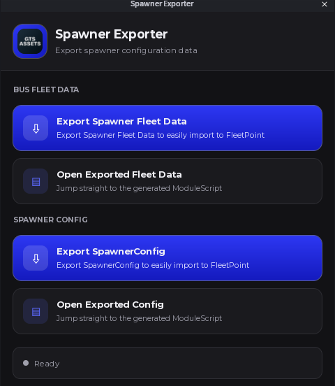
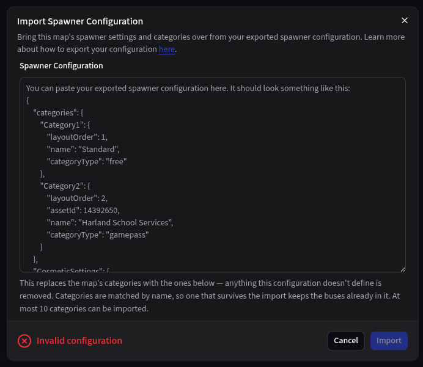

A map is one of your Roblox game's maps. Each map has its own buses, lots, routes, and spawner. Admins can find maps under **Maps > Manage Maps**.

<Info>
  The Free plan includes one map. Creating more requires [Prime](/plans).
</Info>

<Note>
  **Screenshot needed:** The Manage Maps page with a few map cards.
</Note>

## Creating a map

Click **Create Map**, enter the map's name, and click **Submit**. You'll be taken to the new map's settings.

New maps start with a default spawner configuration, automatic temporary assignments turned on, both driver inspection types turned on, and only supervisors and admins able to add routes.

## The map's page

Click **View Map** to open a map's settings. The **Map ID** at the top is what you'll enter in the GDK when you [connect your game](/connect).

### Map settings

Change any of these and click **Save**.

#### Map image

Requires Prime. A map image is a top-down picture of your map. The [Live Map View](/maps/live-map), [Fleet Replay](/fleet/replay), lots, routes, and points of interest all need it.

<Steps>
  <Step title="Render your map">
    Make a top-down render of your map. We recommend RoRender, but any tool that produces a straight top-down image of your map works.

    <Tabs>
      <Tab title="RoRender V4 (paid)">
        [RoRender V4](https://devforum.roblox.com/t/minimap-rorender-v4/3525559) is paid, with a few free renders each day. It renders meshes and supports images up to 7,000 × 7,000 pixels.

        1. Install the [RoRender V4 plugin](https://create.roblox.com/store/asset/102372310431390/RoRender-V4) in Roblox Studio.
        2. Sign in at [rorender.com](https://rorender.com) and click **Create Render** to get a pipeline ID.
        3. In the plugin, press **Start Render** and paste in the pipeline ID.
        4. Click **Auto Configure**, or resize the orange outline so it covers your whole map.
        5. Press **Start Rendering**. Studio may say it's not responding while it works, so don't close it.
        6. When it's done, download the image from **My Renders** on rorender.com.

        See the [RoRender V4 documentation](https://devforum.roblox.com/t/ro-render-v4-documentation/3439638) for more detail.
      </Tab>
      <Tab title="RoRender V3 (free)">
        [RoRender V3](https://devforum.roblox.com/t/minimap-render-rorenderv3/965827) is free, but no longer updated. It only renders part colours, not textures, and large maps can take hours.

        1. Install the [RoRender V3 plugin](https://www.roblox.com/library/10546220005/RoRenderV3) and the [RoRender V3 app](https://github.com/AJSteinhauser/RoRenderV3/releases/tag/1.0). Windows and macOS may warn that the app is unsigned.
        2. Allow HTTP requests by running this in Studio's command bar:

           ```lua
           game:GetService("HttpService").HttpEnabled = true
           ```

        3. Open the plugin, click **Create Settings**, then **Load Settings**.
        4. Resize the purple box so it covers your map by dragging the spheres at its corners.
        5. In the RoRender app, press **Start Server**.
        6. In Studio, click the arrow under **Play** and press **Run**, so your character isn't in the render. Don't click around in Studio while it renders.
        7. When it's done, press **Download Image** in the app to save the render as a PNG.
      </Tab>
    </Tabs>

    <Tip>
      Render from a saved copy of your place rather than your live game, and turn off StreamingEnabled so the whole map is loaded. Remove anything you don't want in the image, like invisible parts.
    </Tip>
  </Step>
  <Step title="Upload the image to Roblox">
    Upload the render to Roblox through the [Creator Hub](https://create.roblox.com/dashboard/creations) or Studio's Asset Manager. Once it passes moderation, copy its **image** ID.

    <Warning>
      Use the image's ID, not a decal ID. A decal ID won't load as a map image.
    </Warning>
  </Step>
  <Step title="Enter the image ID">
    Tick **Enabled** under Map Image, then paste the image ID into **Image ID**.
  </Step>
  <Step title="Set the bounds">
    Enter the in-game X and Z coordinates of the image's top-left corner in **Top Left Corner Bounds**, and of its bottom-right corner in **Bottom Right Corner Bounds**. Put the Z coordinate in the **Y Value** field. These are the corners of the area you rendered. In RoRender, the front of the render box is the top of the image.
  </Step>
  <Step title="Check the preview">
    The **Preview** shows your image with the bounds you entered, along with the map's lots. Adjust the bounds until it lines up, then click **Save**.
  </Step>
</Steps>

<Note>
  **Screenshot needed:** The Map Image fields and the Preview with a lined-up map.
</Note>

#### Temporary assignments

Requires Prime. When **Automatic** is ticked, a bus that goes out of service on this map has its driver moved to a free bus until it's back. See [Automatic reassignment](/fleet/buses#automatic-reassignment).

#### Driver inspections

Choose whether drivers can do **Pre-trip** and **Post-trip** inspections on this map. Mechanic inspections are always available. See [Inspections](/fleet/inspections).

#### Points of interest

Requires Prime. Mark up to 20 places on your map, like depots or schools. They show on the live map and replays, and can be used as [route](/maps/routes) stops.

Drop a pin with the pin tool on the preview, then click it to rename it. Use the edit and delete tools to move and remove pins.

<Warning>
  Routes refer to points of interest by name. Renaming or removing one removes it from any route that stops there.
</Warning>

### Spawner configuration

These settings control your in-game spawner. Change them and click **Save**.

| Setting | What it does |
| --- | --- |
| **Title** and **Logo Image ID** | The spawner's name and logo. |
| **Group Settings** | When enabled, only members of the **Group ID** ranked at or above the **Minimum Spawn Rank** can spawn buses, and members at or above the **Minimum Admin Rank** get spawner admin tools. |
| **Cosmetics Gamepass ID** | The gamepass that unlocks cosmetics. Leave blank for none. |
| **Teleport to Bus** | Teleports players to their bus after spawning it, either **In the Seat** or **Near the Bus**. |
| **Despawn Bus on Player Leave** | Removes a player's bus when they leave the game. |
| **Spawn Type** | **Basic** or **Advanced**. |
| **Use Insert Service** | Loads bus models with Roblox's InsertService. |

### Spawner categories

Categories are the groups players pick buses from in the spawner. A spawner can have up to 10.

Click **Add Category**, then give it a **Name** and choose a **Type**, which decides what a player needs to spawn its buses:

| Type | Requirement |
| --- | --- |
| **Free** | Nothing. |
| **Gamepass** | Owning the **Gamepass ID**. |
| **Group rank** | Being at or above the **Minimum Group Rank** in your group. |
| **Roblox plus** | A Roblox Premium membership. |
| **Clothing** | Owning the **Clothing Asset ID**. |

Drag categories to reorder them, then click **Save**. A category has to be empty before it can be deleted.

### Importing a spawner configuration

If you used the GTS Assets Spawner, you can copy its settings and categories over.

<Steps>
  <Step title="Export your configuration">
    In Roblox Studio, install the [Spawner Data Exporter](https://create.roblox.com/store/asset/122199457306830/Spawner-Data-Exporter) plugin, open it, and choose **Export SpawnerConfig**. Copy everything it exports.

    <Frame>
      
    </Frame>
  </Step>
  <Step title="Paste it into FleetPoint">
    On the map's page, click **Import Spawner Configuration** and paste it in. FleetPoint previews the categories and settings it found.
  </Step>
  <Step title="Import">
    Once it says the configuration is valid, click **Import**.
  </Step>
</Steps>

<Warning>
  Importing replaces the map's categories with the ones in the configuration. Categories are matched by name, so ones that stay keep their buses. A category being removed can't have any buses in it.
</Warning>

<Frame>
  
</Frame>

## Deleting a map

At the bottom of a map's page, click **Delete Map** and type the map's name to confirm.

<Warning>
  Deleting a map permanently deletes everything on it: its buses and their logs, maintenance records, inspections, and activity sessions, plus its lots, routes, and spawner configuration. This can't be undone.
</Warning>

Drivers temporarily moved between this map and another are sorted out first.
