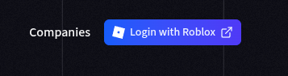
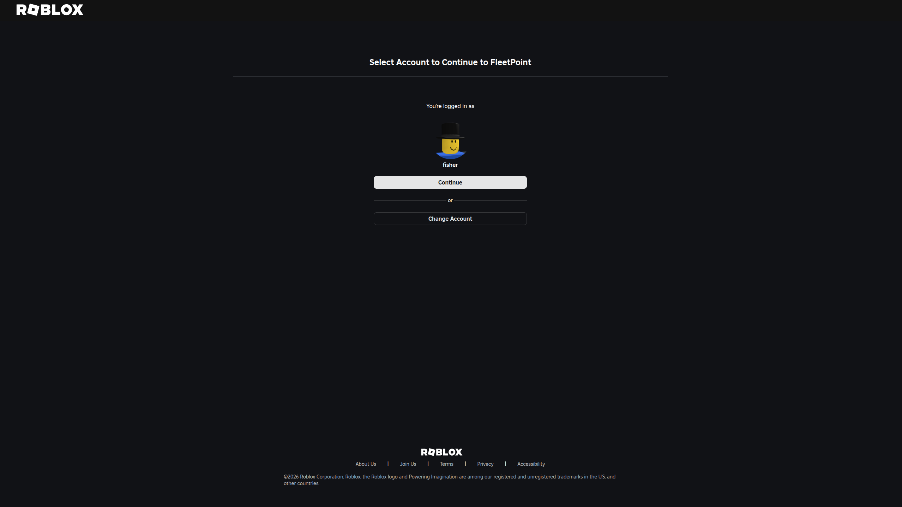
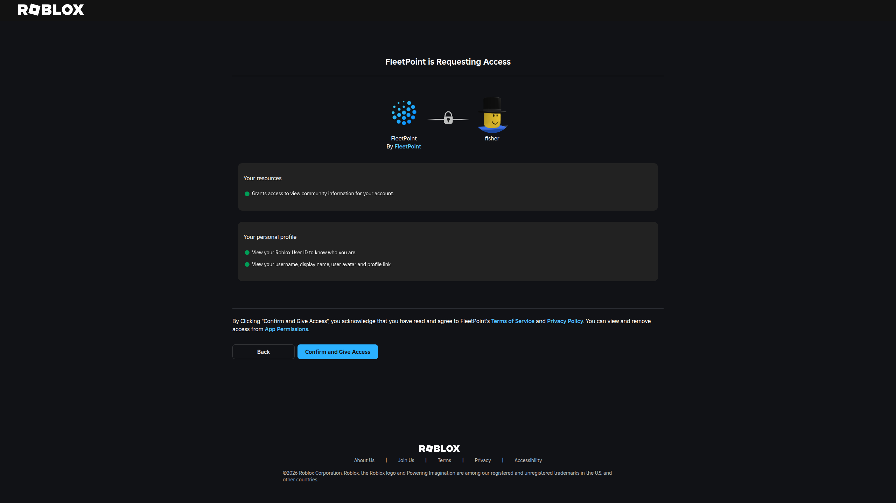
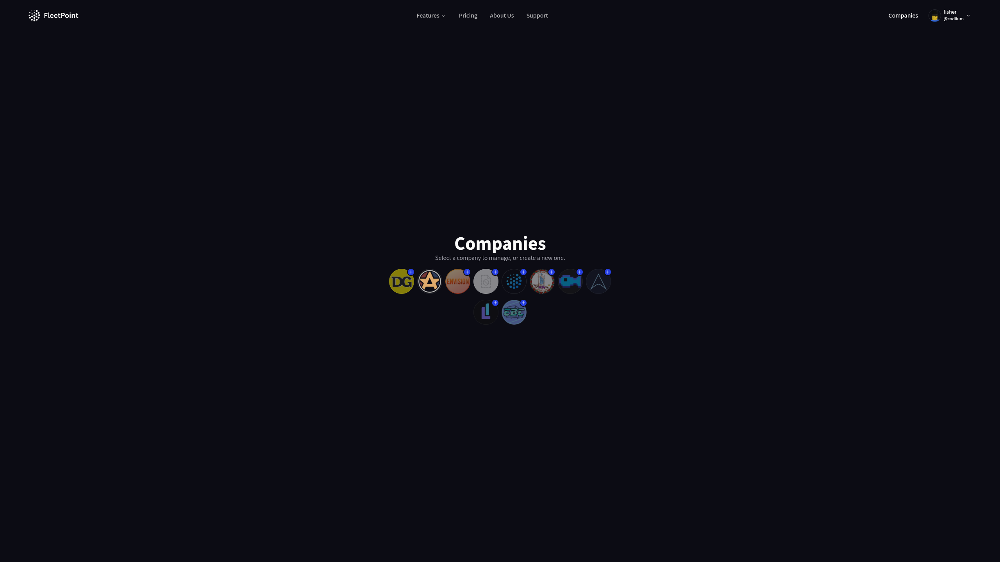
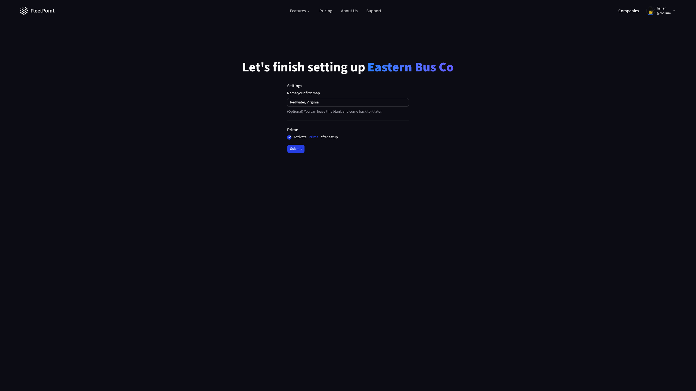
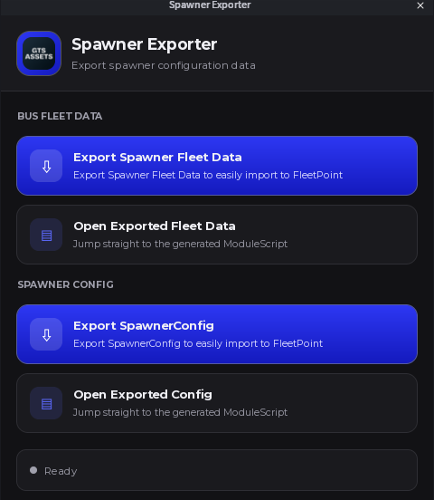
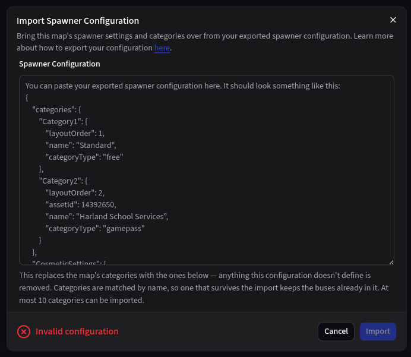

## Prerequisites

Before you begin, you must have:

- A Roblox Account with a group rank of at least 250.

## Get started

<Steps>
  <Step title="Login">
    Click Login with Roblox 

    <Frame>
      
    </Frame>

    From there, make sure you select the correct account and review the permissions it is asking from you.

    <Frame>
      

      
    </Frame>

    After that, you will be redirected back to FleetPoint.
  </Step>
  <Step title="Create a Company">
    Go ahead and choose your Roblox group to create a company for. 

    <Frame>
      
    </Frame>

    Once selected, optionally name your first map, and select if you wish to be redirected to learn how to activate Prime after setup.

    <Frame>
      
    </Frame>

    You can also set the minimum group rank for each role here. See [Roles & Permissions](/roles).

    Then click submit.

    <Info>
      If you chose to activate Prime, click **Manage your Subscriptions on Roblox** on the Subscriptions page to do so. You do not have to do it yet if you do not want to.

      Free trials of Prime are coming soon.
    </Info>
  </Step>
  <Step title="Configure your Map">
    If you haven't created a map, do so now. Head to the "Manage Maps" page to create or configure your map. Once you get on your map's page, configure things such as the Map Image & Map Bounds, temporary assignments, and spawner configuration.

    <Info>
      See [Manage Maps](/maps/manage-maps) for every map setting, and [Lay Out Your Map](/guides/lay-out-your-map) for setting up your map image, lots, and routes.
    </Info>

    As for your spawner configuration, you can either configure it manually or import your configuration if you had a GTS Spawner.

    Install the [Spawner Data Exporter](https://create.roblox.com/store/asset/122199457306830/Spawner-Data-Exporter) plugin generously provided by the GTS Assets Team.

    Once installed, open and select "Export SpawnerConfig"

    <Frame>
      
    </Frame>

    Once complete, it will open a new file with the exported config. Copy (`CTRL + A & CTRL + C`) And then paste that into FleetPoint under "Import Spawner Configuration."

    Ensure that the configuration is valid, and then click Import. **Make sure to save once you are done!**

    <Frame>
      
    </Frame>
  </Step>
  <Step title="Import your Fleet">
    Using the same plugin, click on "Export Spawner Fleet Data," then copy the exported data and head over to the "Manage Fleet" page and click "Import Buses."

    From there, paste what you copied and ensure it is a valid configuration. Then, select the map (and/or lot if you have an active Prime subscription) you want the buses to go to.

    See [Importing buses](/fleet/manage-fleet#importing-buses) for how the import reads your configuration.
  </Step>
  <Step title="Connect your Roblox Game to FleetPoint">
    Learn how to [Connect your Roblox Game to FleetPoint](/connect).
  </Step>
</Steps>

<Tip>
  Need help? Reach out to us at [https://fleetpointapp.com/support](https://fleetpointapp.com/support)
</Tip>